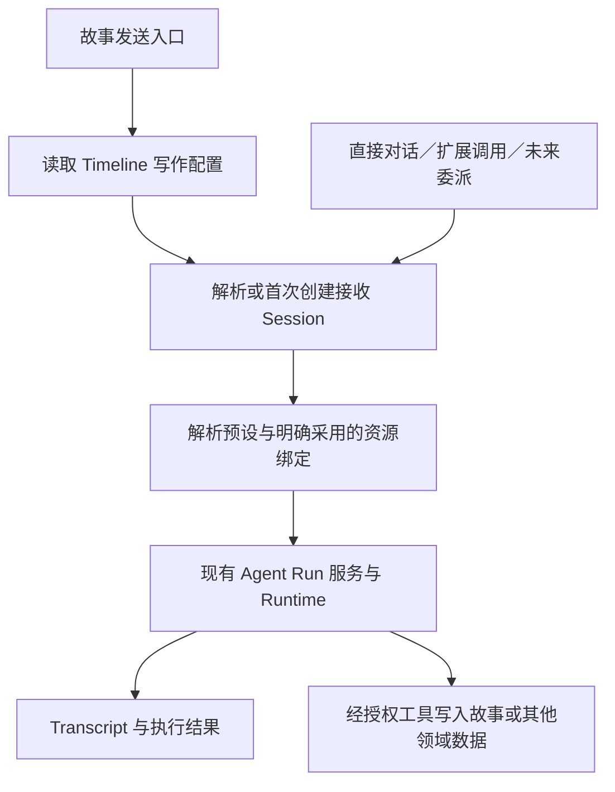

# Agent 通用触发与主写作常驻配置

状态：方向已确认；实施细节待收束，尚未实施。  
日期：2026-10-13。  
本轮授权：记录讨论、源码依据与后续实施边界；不修改业务实现、数据或公共契约。

## 目标与承接关系

用户新建 Timeline 后可以直接发送故事输入，后端按默认写作预设按需创建 Session，并持续使用指定的写作对话。更换预设或写作 Session 不应丢失用户选择的常驻资源；其他 Agent 只有明确采用时才消费同一份配置。

触发执行是一项通用能力：业务功能可以继续已有 Session，或使用指定预设新建 Session。主写作使用这项能力，未来扩展调用、父子 Agent 协作也能复用；不将执行器、资源消费或权限绑定到永久的“主 Agent”类型。

本计划承接 [Agent 预设使用配置、Session 与资源工作台](./agent-preset-resources-and-usage-plan.md) 和 [扩展的故事级采用与运行隔离](./extension-story-participation-plan.md)。实施后替换前者的“主写作仅由客户端保存”及“公共正则默认参与”语义；固定 Session 预设、资源平铺引用、权限与恢复边界继续保留。正式 Architecture 在实现完成后按实际结果更新，当前不得把本计划当作已实现行为。

## 当前事实与问题

以下依据为 2026-10-13 当前源码；不代表运行或人工验收结果。

| 已核对事实 | 影响与入口 |
| --- | --- |
| 主写作 Session 按 Timeline 保存在前端 localStorage；故事发送在未设置时直接报错 | 后端不知道默认接收方，首次发送尚不能自动准备。[Client](../../../apps/studio-client/src/features/narrative-runtime/model/use-narrative-runtime.ts) 的 `primaryStorageKey`、`sendNarrativeInput` |
| Session 固定引用一个 Agent Preset，创建后不能改绑 | 换预设需创建或选择另一 Session，不迁移旧 Transcript。[Session 契约](../../architecture/application/agent/runtime-and-session.md)、[Store 类型](../../../packages/application-data/src/agent/types.ts) |
| Run 服务已有创建、订阅、取消、暂停、审批、恢复和放弃；同 Session 忙碌时拒绝并发执行 | 复用现有执行循环，不增加第二套 Run 管理。[服务](../../../apps/studio-server/src/agents/agent-run-service.ts)、[Runtime](../../../packages/application-runtime/src/runtime/agents-runtime.ts) |
| `sourceRunId` 表达恢复链；调用追踪有 `parentCallId`，尚无父子 Agent Run 合同 | 不能把恢复或 RPC 调用关系当作 Agent 委派。[Runtime 类型](../../../packages/application-runtime/src/types.ts)、[Transcript 类型](../../../packages/application-data/src/agent/types.ts) |
| 全局 Lore 绑定以 `{ kind: 'manual', id: 'global' }` 保存；实际 Agent 提示词只选预设挂载及按配置采用的角色 Lore | 全局绑定存在存储与 UI，却未接入当前 Agent 消费链。[挂载](../../../packages/application-data/src/prompt-resource/mounts.ts)、[组装](../../../packages/application-runtime/src/agents/agent-turn.ts) |
| 世界书 UI 把全局安装扩展中的 Lore 和内置 Lore 加入只读全局绑定集合 | 安装位置被表达成已采用，和真实执行不一致。[工作台](../../../apps/studio-client/src/widgets/context-workbench/context-workbench.tsx) 的 `readonlyGlobalIds` |
| 正则和提取器以预设 `textUses` 覆盖资源 `enabled`；工作区/扩展等资源可以在未被预设引用时参与管线 | 其他 Agent 会继承公共默认候选规则；实际效果仍取决于规则阶段与匹配条件。[文本管线](../../../packages/application-runtime/src/runtime/transforms-runtime.ts) 的 `resolveEffectiveTextPipeline` |
| Tools 只从当前预设挂载集合中选择，再检查启用、条件和来源 | 工具隔离可复用，但尚无独立的主写作常驻工具绑定。[工具解析](../../../packages/application-runtime/src/agents/tool-loop.ts) |
| 资源可用性检查安装目标及 Timeline 采用状态，未直接统一模块启停状态 | 要实现扩展停用后不再消费所属资源，需收束来源可用性含义。[资源访问](../../../packages/application-runtime/src/runtime/extension-resource-access.ts) |
| 故事输入先持久化，再通过节点 ID 投递；最终 Assistant 文本不会自动写入故事 | 保留既有故事事实与执行记录分离，故事写入经授权工具完成。[现有边界](../../architecture/application/agent/runtime-and-session.md#6-narrative-边界) |

## 已确认方向

### 通用执行与主写作分离

- 业务入口决定触发时机、目标和任务；通用能力负责解析已有/新建 Session 并启动一次 Run。
- 同一个预设或 Session 不因被称为主写作而获得额外权限。关联 Timeline 也不等于获得所有故事数据或工具权限。
- 主写作是 Timeline 的默认写作接收配置，与前端当前查看的 Session 分离。
- 新 Timeline 首次发送可按配置自动创建 Session；已有写作 Session 则复用。初次未创建和既有引用失效必须可区分，后者不得静默创建替代对话。
- Session 继续固定引用预设；换预设通过新建/选择另一 Session 后更新接收关系完成，不迁移历史、已执行工具或恢复状态。
- 同 Session 忙碌时沿用拒绝机制，首轮不引入排队。首次并发创建与请求重试需要去重，不能因此重复创建对话或启动 Run。

### 常驻绑定与资源归属分离

- 资源继续平铺，使用稳定 ID 与引用/绑定；不增加“共享资源库”容器、资源嵌套或 Agent Profile。
- “全局”的实际需求是配置不随预设切换丢失，不是所有 Agent 自动消费，也不是资源生命周期属性。
- 常驻配置保存有序引用及必要使用参数，独立于具体预设和临时 Session。首轮整理写作常驻配置，不建设任意分组、嵌套继承系统。
- 主写作功能默认采用写作常驻配置；其他 Agent 的预设或业务入口只有显式采用才使用。可以引用同一资源而不采用整份清单。
- 预设继续提供提示词骨架、模型和自身使用配置。有效资源来自预设绑定、明确采用的常驻绑定及按预设规则采用的角色资源。
- 同一 Lore 按资源 ID 去重，保留全部采用来源。取消一处引用不自动取消另一处；引用不变更所有权。
- Tools、规则和提取器的参数冲突、顺序及关闭语义单独收束，不把 Lore 的集合并集直接套到所有资源。

### 扩展提供资源，宿主执行生命周期边界

- 扩展管理所提供资源的声明和更新；宿主统一落实停用、权限、事务、恢复和来源可用性检查。
- 扩展在适用范围内停用后，所属资源不参与后续执行；资源与绑定保留，已有消息、State 和故事成果不删除。
- 关闭某个设置面板或 UI 模块不自动等同于整个扩展停用；资源对包/模块的实际运行依赖需要明确，纯资源扩展不能被迫增加代码模块。
- 用户需脱离扩展持续使用时，应显式保存独立副本，保留来源说明并明确剩余代码依赖。现有普通复制保留 `origin`，不能直接等同于独立保存。
- 安装范围、故事采用、使用绑定和资源定义自身状态分别表达；安装或被其他 Agent 引用，均不能让已停用来源继续运行。
- 本次 Run 采用的输入/配置与来源凭据纳入既有恢复合同；冻结输入不意味着来源撤销后仍可执行，继续遵守扩展 lease、权限及提交前复核。

## 最小架构

### 状态与职责

| 对象 | 保存或负责的内容 | 边界 |
| --- | --- | --- |
| Agent Preset | 模型、提示词骨架、自身资源采用 | 不承担扩展生命周期、主/子身份或运行历史 |
| Agent Session | 固定预设引用、工作历史、既有运行状态 | 不以 `isPrimary` 开关决定权限或自动接收所有资源 |
| Timeline 写作配置 | 默认预设引用、可为空的当前写作 Session、采用的常驻配置引用 | 后端持久化，区别于前端查看状态；字段/存储类型在实施合同中定稿 |
| 常驻绑定配置 | 有序资源引用与必要的使用参数 | 保存位置和采用范围分离；不复制资源定义，不成为第二份预设 |
| 一次投递与 Run | 输入、目标、调用来源、投递身份、实际资源采用信息 | 复用既有 Run/Checkpoint；只补缺失信息，不建立平行运行状态机 |
| 业务功能 | 何时调用、采用何种配置、如何使用结果 | 主写作只是调用者之一；通用执行器不自动订阅所有事件 |

### 一次故事发送

1. 后端解析 Timeline/Branch、写作配置和默认预设；没有有效预设或模型时，给出明确可操作错误，不猜测替代项。
2. 保留故事输入的节点身份和持久化事实；成功写入后即使投递失败，也不得静默删除或重复追加该输入。
3. 首次需要时创建并关联 Session；关联写入需有并发保护。配置更新、创建和投递的事务划分须在 W0 明确，不能声称跨领域操作天然原子。
4. 用节点引用、目标 Session、明确采用的常驻配置与投递身份调用公共执行入口。请求重试复用同一投递；用户明确重新执行和检查点恢复走各自语义。
5. 返回 Session/Run/投递状态，前端负责展示、订阅及显式失败处理，不再独立决定权威接收方。
6. 输出留在 Session；故事写入继续通过授权工具，不增加“最终回复自动写正文”分支。

首次初始化不自动恢复旧 Run。重复投递保护不能承诺外部 Provider 在任意崩溃点只计费一次，也不能自动重放结果不确定的工具副作用。

### 本次资源解析

预览与正式执行共用同一条解析路径：读取消费配置 → 合并并保留来源 → 校验可用性与权限 → 按各资源类型规则生成候选集合 → 使用预设骨架构建 Prompt/工具/文本管线。

不把全局安装或资源的 `enabled` 当成用户已采用的替代证据；定义可用、绑定启用和本轮 Activation 分别可解释。UI 应展示实际引用及不可用原因，而不是从安装位置推导默认绑定。

LoomScript 渲染挂载属于界面生命周期，本轮不把用户/工作区/角色/预设的渲染范围强行收进 Agent 消费解析。扩展动态 Prompt 附加继续复用现有 `promptAddition`/处理器路径，不新建第二套广播注入引擎。

## 实施顺序与文件边界

下表是后续工作包，不构成本轮修改实现的授权。新增文件名与确切字段由 W0 收束；沿用现有模块，不开展全仓重构。

| 工作包 | 负责内容与主要范围 | 完成条件 |
| --- | --- | --- |
| W0 合同收束 | 本 Plan；核对 [Runtime 类型](../../../packages/application-runtime/src/types.ts)、[Session Store](../../../packages/application-data/src/agent/)、[Timeline Store](../../../packages/application-data/src/narrative/)、[Document 类型](../../../packages/application-runtime/src/foundation/document-types.ts) | 解决下方会影响产品/迁移的决策；确定写作配置、投递身份和资源合并最小合同 |
| W1 后端主写作与通用投递 | `packages/application-runtime/src/runtime/{agents,narrative}-runtime.ts` 及必要领域模块；`apps/studio-server/src/agents/agent-run-service.ts`；`apps/studio-server/src/rpc/trpc/application/`；W0 指定的持久化文件 | 后端保存接收配置；已有/新建 Session 均调用同一 Run 服务；首次创建与重复请求不重复执行，恢复/忙碌规则保留 |
| W2 常驻引用与来源解析 | `packages/application-data/src/prompt-resource/`；`packages/application-runtime/src/agents/{agent-turn,tool-loop}.ts`；`runtime/{prompt,transforms,extensions}-runtime.ts`、`runtime/extension-resource-access.ts`；必要的 `extensions/`、`prompt/` 模块 | 主写作明确采用常驻配置；其他调用隔离；预览与运行一致；扩展来源停用可撤销；确定的数据迁移完成 |
| W3 Client 接线与使用反馈 | `apps/studio-client/src/features/narrative-runtime/`、`features/prompt-resources/`、`widgets/{context,preset}-workbench/`、必要的 `features/text-transforms/` 与 `shared/api/`、`shared/i18n/` | 新故事直接发送；换预设/接收 Session 保留常驻采用；页面选择不改接收方；绑定来源与不可用状态准确 |
| W4 验收与文档同步 | 与修改链直接相关的现有测试；`docs/architecture/application/{agent,prompt-build}/`、相关文本管线/扩展生命周期文档与本 Plan | 行为验收成立后再更新正式合同与实施结果，保留未验收边界 |

W1/W2 都可能修改 Agent Runtime 与类型；未分清写集前不并行派发。主 Agent 负责架构与集成判断，Worker 只按已定合同实现，不自行决定迁移、权限或冲突优先级。

独立保存资源的 UI、依赖脱离和副本绑定切换另行细化；本 Plan 记录生命周期原则，不把已有 `duplicate` 接口直接改名后视为完成。该能力不是首轮触发闭环的前置条件。

## 待收束决策

由用户与主 Agent 决定，实施 Agent 不自行补全产品语义；可先推进不依赖这些决定的设计工作。

1. **常驻绑定冲突与关闭语义（阻塞 W2）**：同资源被两处采用时，工具启用、Anchor/顺序、规则参数如何合并；是否需要局部排除常驻项。已确认 Lore 去重与保留引用来源，不能据此推导所有字段的覆盖规则。
2. **消费配置的适用入口（阻塞 W1/W2 接口定稿）**：直接打开主写作 Session 发消息是否默认采用写作常驻配置；其他 Agent 是按预设持续采用还是仅单次调用采用。不能只检查 Session ID 就悄悄扩大消费范围，也不能因换发送入口意外丢失必要配置。
3. **默认预设与迁移（阻塞 W1 数据落地）**：默认预设从已有 Card/应用选择的哪一层取得；新 Timeline 如何确定；多客户端的 localStorage 主接收方如何一次性导入后端，冲突时不能静默覆盖。首次未配置、Session 删除、归档/导入后的引用缺失分别处理。
4. **旧资源默认行为迁移（阻塞 W2）**：已有 `manual/global` Lore、公共启用的正则/提取器及显式 `textUses` 如何转成引用配置；没有真实绑定的全局安装资源不自动新增采用。规则的 display/classify 等非 Prompt 消费需逐条确认，不能一刀切删除所有公共规则路径。
5. **扩展可用性的粒度（阻塞 W2 来源统一）**：包停用、单模块停用、故事暂停分别影响哪些贡献；无代码包、跨模块依赖及全局/Card 卸载差异需要核对后收束，不能要求作者仅靠 dispose 自行保证宿主数据不被消费。

投递持久化、Session 创建竞争及失败重试由 W0 基于现有事务确定最小实现，普通实现选择不另设审批。若需要改变外部副作用恢复或权限语义，再回到用户决策。

## 验收与验证预算

- 新建 Timeline，在有效默认预设下首次发送即可创建并关联一个 Session；后续发送复用。并发首次请求不产生多个接收方；同一投递重试不重复追加故事输入或启动执行。
- 服务器重启、页面刷新后接收方仍可查询；打开其他 Session 不改变它。未配置和失效关联均有明确行为；生成/暂停时切换遵守既有安全边界。
- 直接调用已有 Session，以及按指定预设新建 Session，都复用现有 Run 入口且不必先成为主写作；同 Session busy 行为保留。
- 换预设或写作 Session 后，常驻资源按配置保留；未显式采用的其他 Agent 不继承。Lore 多来源只注入一次，来源可追溯；工具与规则按照 W0 决议合并。
- 预览与执行使用相同消费合同；检查点恢复不偷换配置、重放已完成工具或绕过已撤销的扩展来源。
- 扩展停用后相关资源停止参与后续执行，引用/历史/State 保留。全局安装本身不被显示成真实消费绑定。
- 不回退“最终 Assistant 文本不自动写入故事”的合同，不因主写作或父子关系扩大权限。

实施时优先复用现有 Store/Runtime/Server 和客户端命令测试，定向覆盖首次创建竞争、重复投递、消费隔离、迁移与恢复边界；必要时补最少的重要行为用例，不建设测试体系。跨层类型变更才运行相应类型检查；文档阶段仅检查 Diff、引用路径和决策一致性，不运行测试/build，不启动浏览器。主观 UI 验收由用户完成。

## 首轮之外

- 父子 Agent 的完整调度、结果等待/交接、取消传播、循环委派与预算管理；未来复用执行入口，但当前不假称已支持。
- 通用事件规则编辑器、任务队列、工作流 DAG、任意常驻组嵌套与复杂继承。
- 跨预设 Session 历史转换、自动重放旧 Run、无条件复制父 Agent 权限与资源。
- LoomScript 渲染体系重构、模型调用器重写、资源嵌套存储与新的 Agent Profile。

## 记录

2026-10-13：完成方向与源码事实记录，并加入施工索引；所有实施工作包尚未执行。本次不改变正式 Architecture 或存量数据。
