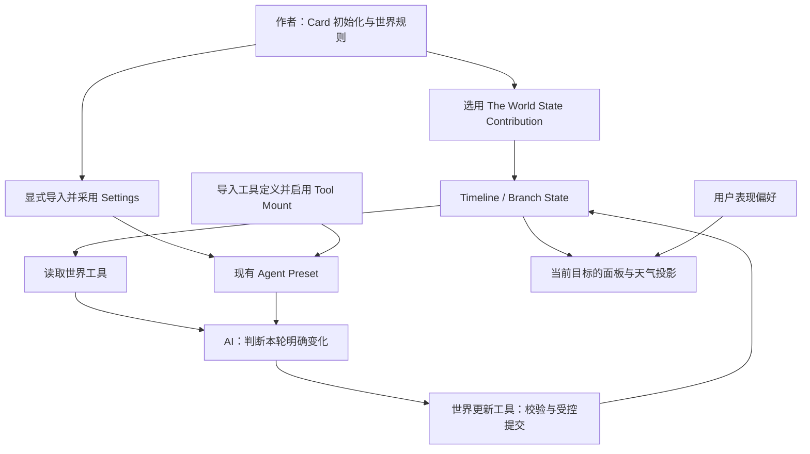

# The World 世界状态与 AI 接入计划

> 状态：实施中 / State v2、可信工具上下文与 dist 分发准备已实现；Client 自动跟随与刷新未完成。
> 日期：2026-10-02
> 更新：2026-10-05，用户已批准 State v2 / 显式升级、工具可信上下文及扩展 dist 移出 ignore；未授权推送发布。
> 目标：让作者初始化、AI 读写、运行面板与天气表现消费同一份分支世界状态。
> 当前源码：`extensions/the-world/`，独立扩展版本 `0.1.4`；不以旧 `official/extensions/the-world/dist/` 为施工入口。

## 1. 当前判断

保留原 ST 的闭环：世界事实与地点关系为 AI 提供上下文，AI 提交明确变化，地图、场景和天气随事实更新。但不迁移 ST 的世界书双写、localStorage 世界数据库、正文标签自动副作用和任意宿主 CSS 注入。

Loom 已有 State、Setting、Agent Tool、Preset 和 Renderer，不需要再造一个世界引擎。首个交付切片是“初始化世界 → AI 读取 → 局部提交 → 面板刷新”；完整地图操作、自动 Atlas / Locator 注入、音频和导入 UI 不作为前置。

本 Plan 保留初始调研与提案作为决策记录。State v2、分支身份整理和服务端工具上下文已获批准并实施，最新结果以第 10 节第二批账目为准；Client 目标与刷新合同尚未扩张。

## 2. 已确认事实与证据

| 事实 | 当前证据入口 |
| --- | --- |
| 云 PNG 源码路径相对 `src/client/` 正确，打包到 `dist/client.js` 后向上两级越出 Package 文件根；构建没有处理 PNG URL | `extensions/the-world/src/client/clouds-3d.js`、`scripts/build-client.mjs` |
| 有实体合同、空根 State Contribution、读写 RPC、两个工具定义与执行器；没有配套 Prompt Settings / Preset 贡献 | `src/contracts.ts`、`src/server/index.js`、`manifest.json`、`resources/agent-tools/` |
| Contribution 在 Card 显式选择后于创建 Timeline 时物化；启用扩展不会给所有现有 Timeline 自动补数据 | `docs/architecture/application/state-and-variables.md` |
| Settings 与 Tool Definition 需显式导入；Preset 的 Setting Mount / Tool Mount 决定消费，不因模块启用自动进入全部 Agent | `docs/architecture/application/prompt-build/README.md`、`docs/architecture/extensions/README.md` |
| 服务端已有 `state.subscribe`，The World 尚未消费；Client 没有同等的通用 State 事件订阅接口 | `packages/extension-sdk/src/index.ts`、`docs/workbench/issues/state-subscription-for-extensions.md`、`docs/architecture/extensions/client-renderer-host.md` |
| 扩展 Tool Handler Context 目前只有 `signal`，不能直接取得可信 Turn 目标或 Invocation ID | `packages/extension-sdk/src/index.ts` 的 `ExtensionAgentToolHandlerContext` |
| 面板靠手填目标读取；场景、时间、天气各自取第一个匹配实体，预览修改不提交 State | `src/client/panel-view.tsx`、`src/client/index.js` |
| 未知 mutation 操作落入删除组件分支；非法月份、小时等整数可通过服务端校验 | `src/server/index.js`；本轮只读运行探针已复现 |
| 地图读取 `parentId / parent`，合同定义 `parentPlaceId`；合法午夜被 `Number(hour) || 12` 显示成中午 | `src/client/panel-view.tsx`、`src/contracts.ts` |

相对路径 `src/`、`resources/` 在本 Plan 中均指 The World 扩展根。历史迁移讨论和升级报告仅作背景，不替代当前代码。此前未做真实 Provider、安装包资源请求或浏览器视觉验收。

## 3. 数据与职责

| 归属 | 内容 | 边界 |
| --- | --- | --- |
| Timeline State | 当前场景、地点关系、世界时间、历法、天气与媒体引用 | 唯一运行事实，按 Branch 修订；不复制进 Setting |
| Prompt Settings | 世界规则、字段含义、更新时机、未知值处理、工具使用示例 | 作者可编辑；不是当前天气、时间和位置的第二份数据库 |
| Agent Tools | 读取世界、校验并提交局部变化 | 通过现有 State Service，保留冲突、幂等与 Changeset |
| Preset 使用配置 | 显式采用 Settings、启用世界工具 | 不自动修改用户已有预设，不要求专属 The World Agent |
| 扩展 Config | 特效启用、预览参数等用户偏好 | 不写剧情；表现关闭不停止世界事实更新 |
| Renderer | 展示当前目标的权威快照及诊断 | 不按“第一个实体”猜当前场景，不维护第二套剧情状态 |



## 4. State 最小设计提案

### 4.1 当前世界与实体

继续使用 `theWorld.entities`，固定 `world` 实体表达当前世界，不新建地图数据库。建议增加 `world` 组件：

```ts
type WorldComponent = {
  version: 1
  currentSceneId?: string
}
```

`world.components.world` 持有当前场景指针；其 `worldTime`、`calendar`、`weather`、`background` 组件保存世界级时间、默认天气和默认背景。Scene 保存名称、描述、`placeId`、参与者引用及可选场景天气 / 背景；Place 保存名称、父地点、连接、短事实和资源引用。

投影统一从 `world → currentSceneId → scene.placeId` 取值。场景天气 / 背景优先于世界默认，这是明确的领域继承语义，不是静默掩盖损坏数据。时间只读世界实体；未指定当前场景、未知天气或缺少日期必须显示未知，不取任意其他实体、不造系统日期。

首版不新增 NPC 实体种类、移动规则、路径规划、时间自动推进或地图编辑器。现有参与者引用保持原合同；不把姓名强行转换为不存在的实体。

### 4.2 初始化与版本

Contribution 至少提供固定 `world` 实体和空 `world` 组件。地点、Scene、日期和历法由作者初始化；没有来源就不填“晴天 / 2024 年 / 默认 Gregorian”。提供一份完整可运行的示例 State，和空世界模板分开。

Card 通过现有 `stateContributionIds` 选用该 Contribution，作者按现有 Card State 配置补充内容。不用第二个 Extension Contribution 覆盖同一路径，不绕过组合时的身份冲突检查。

现有 Timeline 不因启用、reload 或安装新版被改写。缺根时工具明确报告未初始化，不隐式创建世界。旧数据需版本识别、只读预览和显式升级；具体版本号、升级入口与旧根处理在实施前定稿。

当前快照及实体重复保存 Branch 身份；Fork 复制旧快照后可能与新目标冲突。实施前必须用真实 Fork 路径核对。推荐让宿主 target 拥有分支身份，业务 JSON 不再复制可漂移的 Branch 标记；若需改变持久结构，先确认 schema 升级与显式迁移，不静默抹去旧字段或自动重绑定。

### 4.3 写入约束

RPC 与工具共用同一套可执行校验和操作语义，避免 `world-model.ts` 与 `server/index.js` 继续漂移。优先复用宿主已支持的 Schema / Pointer 能力；不为共享少量逻辑新建通用框架。

必须拒绝未知操作、非法组件形状、非法时分、非法自定义月份 / 日期以及非 JSON 值。日期按对应 Calendar 校验，不用 JavaScript Date 把自定义历法自动折算为 Gregorian。未提供 Calendar 时不得伪装日期有效。

当前场景及其地点引用必须可解析；删除正在使用的 Scene / Place 时，要求同一请求修正引用或拒绝。父地点与连接不得把其他分支数据合并进来。校验发生于整批操作的最终结果，允许同一批创建目标并建立引用；删除不是默认工具行为。

继续允许真实局部修改，保留未修改实体。首版不扩张 JSON Patch 操作集；必须明确数组是否支持，当前自制实现不能处理数组元素，不对 AI 宣称完整 RFC 6902。外部工具参数应列出支持操作、路径和值约束。

## 5. Settings 与 AI 工具接入

扩展携带一份“世界状态维护规则” Setting，Manifest 通过 `contributes.promptResources` 分发。内容保持最小：字段关系与稳定 ID、先读后写、只记录明确变化、不编造未知事实、无依据不推进时间、冲突后重新判断，以及一组读取 / 局部修改示例。

角色长篇世界观继续使用作者自己的 Settings。首版不新增强制专属 Preset：用户在现有 Preset 显式采用维护规则、启用两个世界工具；示例 Card / 使用文档演示完整配置。安装、资源导入、模块权限和工具挂载是四个不同步骤，缺一项给出明确诊断。

保留 `official.the-world/read-world-state` 与 `official.the-world/update-world-state` 两个身份，先不复制 ST 的 AddNPC / SetProperty / AddPOI 工具集。读取返回 The World 子树、当前场景和 revision，不把无关全量 State 交给 AI；更新只提交受限实体 / 组件变化。

建议的 AI 参数边界：

- 读取当前 Turn 的世界，不让模型猜 Timeline / Branch。
- 更新仍携带读取所得 `expectedRevisionId`，不能由执行器改为“提交时最新版本”。
- target 与幂等键来自可信 Turn / Invocation，而不是模型自报；同一 Invocation 的重放不产生第二次写入。
- 当前 SDK 不支持这条自动绑定链路，不能直接删掉已有必填字段。先检查官方 State 工具和扩展执行入口的授权；确需新增最小上下文字段时另行确认公共合同。
- 未绑定 Narrative 的调用不得猜最近聊天。本阶段保留开发 RPC 的显式目标；非叙事 Agent 使用世界工具的授权策略待定，不直接开放任意分支。

真实幂等验证必须经过 Handler 和 Host。现有执行器先读最新 revision 并报冲突，可能在宿主幂等重放之前阻止重试；修复应保留同键不同请求拒绝及 stale revision 冲突，不简单删除并发检查或自动生成新键。

首版通过读取工具把实时事实交给 AI。已有 Atlas / Locator 纯投影可后续复用，但不把动态摘要写回 Setting，不新建通用 Prompt Source Registry，不承诺所有 Agent 自动获得地图信息。

## 6. 面板、预览与资源

云层控制器接受调用方传入的 URL；激活入口用 `context.files.url('assets/images/cloud.png')` 获取 Package 受控地址。验证打包后仍落在同安装、同版本的 Package 路径，包含 Card 私有安装场景；不靠仓库 URL 或加载失败时换图掩盖错误。

正式运行面板只展示当前目标的 State。预览单独标记为调试模式；调试参数仅影响预览，不覆盖正在运行的剧情背景。正式“改变时间 / 天气”若保留，必须调用写入 RPC 并按 revision 提交，不能只改 CSS；首版可先移除这类误导性入口，只保留只读运行显示。

修正 `parentPlaceId`、午夜显示、天气映射和受控滑块 / 开关；未实现的音频、地图模式、重置 UI 等控件移除，不用无行为控件冒充功能。地图首版只读展示父子及连接，“前往”在语义确认前不作为可点击动作。

Workspace Renderer 的活动 Timeline / Branch 获取与变化通知需要核对当前 Host Context。不得通过主应用 DOM selector、localStorage 或服务端全局变量推断。没有正式目标时显示未绑定；手填目标可保留为明确的调试入口，但不算完成正常运行体验。

服务端 `state.subscribe` 可复用；Client 刷新优先检查既有 Renderer `update`、Projection 失效通知及 State 读取链路。仅服务端能订阅不等于浏览器能收到。若现有合同不足，记录最小 Host 补充，不建设轮询或通用跨端事件总线。

目标切换、刷新、配置加载和主题加载要防止晚结果覆盖当前目标；使用目标代次 / 取消机制，不比较不透明 revision 的字典序。停用后取消请求、释放订阅、动画和样式；不得恢复并覆盖后来由其他消费者设置的背景。

世界天色 / 天气投影优先使用正式 Renderer / Background 能力。当前宿主 DOM escape hatch 不作为新功能的稳定接入点；若宿主尚无必要表现能力，延期全局同步并说明，不以独立调试预览代替完成。

## 7. 实施工作包

| 工作包 | 文件边界 | 可观察交付与主要验证 |
| --- | --- | --- |
| P0 云资源修复 | `src/client/clouds-3d.js`、`src/client/index.js`；必要的定向验证 | URL 经 Package API 传入；客户端构建及打包入口 URL 解析，安装包路由读取 PNG 成功 |
| P1 合同定稿与安全写入 | `src/contracts.ts`、`src/world-model.ts`、`src/server/index.js`、`docs/state-contract.md`、`tests/extensions/the-world/server.test.ts` | 明确版本 / 分支 / 数组语义；非法操作拒绝、引用一致、合法日期；真实 Handler + Host 冲突 / 重放证据 |
| P2 初始化与提示资源 | `manifest.json`、`resources/`、`README.md`、必要的导入 / Card 定向验证 | 新 Timeline 显式初始化；旧 Timeline 不改写；Setting 与两工具导入、挂载后实际进入 Prompt / tools |
| P3 可信工具上下文 | 先只读核对 `packages/extension-sdk/src/index.ts`、Host、`packages/application-runtime/src/agents/` 与官方 State 工具 | 定稿最小合同后才开放宿主写集；验证当前 Turn 目标不可越权、取消、幂等和无目标拒绝 |
| P4 同源投影与运行面板 | `src/client/index.js`、`src/client/panel-view.tsx`、实际涉及的天气模块 | 当前 Scene / Place 一致；State 写入刷新、目标切换不串世界、午夜正确；缺目标明确诊断 |
| P5 文档与验收收口 | 包内 README、相关合同 / 迁移文档、本 Plan | 设置与工具操作链路可复现；记录真实模型、资源路由、浏览器诊断与人工验收各自结果 |

默认顺序 P0 → P1 → P2 / P3 → P4 → P5。P1 的日期、Fork 与版本问题，P3 的可信上下文，P4 的 Client 目标 / 刷新合同需先定稿；阻塞其中一项不扩大成全平台重构，也不阻止独立云路径修复。

独立扩展不重新加入主仓库跟踪；实际独立 Git 根和开发链接在实施时确认。旧迁移文件更新引用本 Plan，不删除历史记录；只清理本次改动产生的孤儿代码。已有脏工作区保持不动。

## 8. 完成标准与验证预算

1. 示例 Card 显式选用 Contribution，创建 Timeline 后获得可校验的世界；启用模块不隐式升级既有 Timeline。
2. 导入维护规则和工具后，只有采用它们的 Preset 能向 AI 提供正确 Setting 与工具定义；停用执行器给出明确失败。
3. 确定性 Provider 执行真实 Runtime / Handler / State 链：读取、修改局部天气或时间、再次读取一致，其他实体保留。
4. 非法操作、错误日期、跨目标调用、stale revision 和同键不同请求拒绝；同请求重放不增加 revision / 副作用。Fork / 历史分支读取保持一致，不被重复 branch 标记阻断。
5. 面板和天气读取同一当前目标；明确区分未知、未初始化、读取失败与调试预览，切换和停用不遗留旧结果。
6. 构建后的云 PNG 请求使用正式 Package URL 并成功读取；不将纯源码路径推断当浏览器运行证据。

每个工作包只运行直接覆盖其风险的定向检查。合同 / 类型变化才追加相关包类型检查；云 URL 或入口变化才构建客户端，不默认全仓 lint / test / build。

新增非平庸写入与并发逻辑需要最小回归证据，优先扩展现有 The World 和宿主测试，不新建测试框架。`scripts/smoke.ts` 只覆盖天色与迁移解析，不构成 AI 读写、分支或停用证据。

浏览器仅用于资源请求、DOM / 事件和生命周期的客观诊断；整体观感、动画、移动布局与操作手感由哥哥人工验收。真实外部模型调用需独立记录；确定性 Provider 验证不能替代它，也不自动消耗真实 API 额度。

## 9. 开放问题与停止条件

| 问题 | 推荐方向 | 对实施的影响 |
| --- | --- | --- |
| `world` 组件、schema 版本及旧分支标记如何处理 | 最小当前场景组件；宿主 target 为分支权威；旧数据显式升级 | 持久化合同定稿前不迁移 |
| 工具如何获得可信目标与幂等身份 | 复用官方 State 工具已有的 Turn / Invocation 语义，最小扩展 Handler Context | 涉及公共 SDK / 授权，先确认 |
| Client 如何跟随目标并得到 State 刷新 | 复用现有 Context / Renderer 更新链；缺合同就明确补充范围 | 不承诺已有 Server 订阅可直接用于 Client |
| 动态天空如何走正式宿主表现能力 | 先满足根内渲染；正式能力不足则延期全局同步 | 不新增 DOM selector 或万能 CSS 注入 |
| 旧世界如何首次升级 | 显式预览 / 确认；不自动初始化既有 Timeline | 迁移规模超出最小升级时拆后续计划 |

只有需要改变公共契约、权限、持久化或已确认范围时暂停相关工作包并请哥哥决定。普通实现细节、定向测试失败和本次回归由实施者自行处理。禁止发布、推送、自动迁移用户数据或运行生产副作用，除非另获明确授权。

## 10. 执行账目

- [x] 完成初步源码与正式合同调研，区分事实、提案和宿主缺口。
- [x] 写入本 Plan 并加入活跃索引。
- [x] 完成 P0 云 URL 修复与 Global 安装包路由验证；Card 私有安装路由验收仍未执行。
- [x] 完成 P1 服务端未知操作、时分秒范围和数组遍历拒绝；不代表完整组件 / 日期合同完成。
- [x] 定稿 P1 合同并完成真实 State Service 写入、重放与 Fork 验证。
- [x] 完成 P2 维护 Settings 分发与显式采用、工具启用及执行器缺失的本地编译验证。
- [x] 完成 P2 Settings / 工具 / 初始化示例。
- [x] 定稿并实现 P3 工具可信上下文；完整 Provider → Server 桥接链仍待验收。
- [ ] 完成 P4 运行投影与面板收口。
- [ ] 完成 P5 验收记录；人工或外部模型未验收项不得标为通过。

### 2026-10-05 首批实施

实际完成：

- 云层不再使用打包后漂移的 `import.meta.url`，激活入口通过 `context.files.url()` 传入 PNG URL。客户端 bundle 已重新生成。
- 服务端 mutation 明确拒绝未知操作；校验时、分、秒、毫秒及月 / 日的正值。未硬编码 Gregorian 日期上限，Calendar 引用及月长校验留给 P1 合同定稿。
- JSON Patch 拒绝穿越数组或标量，避免 `add` 将既有数组静默替换成对象；数组整体替换仍可用。`world-model.ts` 的纯数据实现尚未统一，不能据此声称两条路径合同已收口。
- 地图使用正式 `parentPlaceId`；午夜零点保留；多云选择、时间预览及切主题统一沿用当前天气映射。滑块 / 开关自身状态、当前 Scene 投影和全局表现生命周期仍未完成。
- Manifest 新增 `world-state-maintenance` Setting 贡献，按当前 Prompt Resource v2 / Activation / Anchor 合同组织；README 说明安装、权限、显式导入和 Preset 采用链路，不自动创建专属预设。

验证：

| 检查 | 实际结果与证据边界 |
| --- | --- |
| `pnpm --dir extensions/the-world run build` | 通过；验证客户端打包，不替代浏览器表现 |
| 三个定向文件：`server.test.ts`、`cloud-assets.test.ts`、`resources.test.ts` | 17 项通过；包含真实 HTTP 安装包云 PNG / bundle 读取、真实 Handler 拒绝非法提交及 SQLite Runtime Prompt / 工具编译 |
| `pnpm --dir extensions/the-world run typecheck` | 通过；扩展源码类型检查 |
| `pnpm test:extensions:typecheck` | 通过；包含本次扩展测试的类型检查，不作为主应用 CI 结果 |
| 浏览器 / 外部 Provider | 未执行；没有真实模型调用、Card 私有安装 PNG 路由或桌面 / 移动人工验收 |

测试中的初始阻塞均已处理：开发目录的依赖软链接不能作为发行包，临时包排除 `node_modules` 后走正常安装；默认工具挂载记录存在但禁用；Fake Provider 不支持原生工具；真实维护 Setting 需要 Activation / Anchor，导入成功不等于注入成功。没有放宽安装安全或改动宿主行为。

下一步决策证据：

- `packages/application-runtime/src/runtime/narrative-runtime.ts` 的 Fork 复用原 State revision，未重写业务 JSON。The World v1 的根与实体 branch 标记会与新 target 冲突；这是源码核对，不是已经完成真实 The World Fork 验收。
- `apps/studio-server/src/main.ts` 当前扩展工具桥接只转发参数与取消信号，不转发 `ToolExecutionScope` 或 Invocation ID；Host 再包装时也只保留信号。需确认最小可信 Narrative target / Invocation 合同后才能移除 AI 参数中的目标与幂等键。
- 推荐将 `world` 组件、宿主 target 权威及显式 v1 → v2 升级一并定稿；不自动修改既有 Timeline。推荐仅绑定当前 Narrative 的世界工具，未绑定时明确失败，而不是开放任意分支。
- 当前 `extensions/the-world` 没有自己的 Git 根，属于主仓库忽略的本地目录；没有将源码重新加入主仓库、提交、发布或推送。

实际偏差：P1 / P3 的合同决策阻止完整 State 初始化与自动上下文接入，先完成独立 P0、P1 已知拒绝路径、P2 Settings 和 P4 明确字段错误。没有把这些部分完成标成整个运行闭环已交付。

完成后按项目规则更新本 Plan 并归档；有独立未完成工作时拆出后续，不把未验收风险写成已经消失。

### 2026-10-05 第二批实施

已确认边界：采用 State schema v2，固定 world / currentSceneId，宿主 target 独占分支身份；旧数据仅显式预览并提交升级。公共 SDK 增加 invocationId 和可选 narrativeTarget，不把模型参数当授权依据。仅移除扩展自身 `dist/` 忽略，不改变主仓库 `/extensions/` 跟踪边界。

实际交付：

- `src/world-state.js` 统一 RPC、工具和客户端投影；校验组件、Calendar 日期、地点引用及父级环；未知不补默认剧情。业务根和实体去除 branch，时间戳可选。
- `src/server/index.js` 注册 v2 空世界 Contribution，read 只返回 The World 子树；局部 patch 转为确定性宿主 operations。使用宿主真实幂等与 revision 检查，重放不覆盖后来的 head。
- 新增 previewWorldUpgrade / commitWorldUpgrade。预览不写；提交验证预览内容与 revision；没有自动升级、静默丢弃坏数据或升级 UI。
- SDK、Extension Host、Studio Server 贯通 invocationId / narrativeTarget；模型不得自行传目标或幂等键，未绑定 Narrative 拒绝，取消信号保留。
- 维护 Setting 和两工具输入同步 v2；完整自定义历法 / Scene / Place 示例位于 `resources/examples/world-v2.json`。旧导入资源不自动覆盖，需要重新显式导入与采用。
- 面板读取与调试模型按固定世界指针投影，不再取首个实体，也不再将未知日期显示成 2024 年。但仍为手动目标刷新，旧实验全局预览及无效控件尚待 P4 收口。
- 扩展 `.gitignore` 移除 dist；重新生成 `dist/client.js`。Release 工作流检查客户端产物存在，并将 dist / assets 等运行必需文件纳入归档。

验证账目：

| 检查 | 结果及边界 |
| --- | --- |
| 四个 The World 定向测试文件 | 19 项通过：纯合同、SQLite Runtime / State Service、Settings / 工具编译，以及实际 HTTP 安装包 PNG / bundle 请求 |
| `tests/contract/extension-host/installations.test.ts` | 3 项通过；真实 Host 保留调用 ID / Narrative target、独立安装执行器与销毁 |
| 扩展 typecheck、test:extensions:typecheck、Studio Server 定向 tsc --noEmit | 均通过；首次 server 命令错误禁用 composite 的 incremental，修正参数后通过 |
| 扩展 build / smoke | 通过；验证 bundle 与显式历法迁移解析，不代表视觉验收 |
| 临时独立 Git 仓库 ignore 探针 | dist/client.js 可列为未跟踪文件，check-ignore 返回未忽略；没有修改源目录 Git 状态 |
| 外部 GitHub 安装 / Provider / 浏览器 | 未执行；没有公网仓库安装、真实模型调用或人工视觉验收 |

补充说明：首次直接运行默认 Vitest 没有选中 extension 测试，随后使用 `pnpm test:extensions` 真正执行。面板及测试类型收口产生的类型错误已修复；没有把未执行或错误命令记作通过。

未完成和下一阶段边界：

1. P4：Client Renderer 尚无可信当前 Branch 与 State 更新订阅合同。需定稿最小宿主补充，之后再做自动跟随、刷新、异步结果隔离、预览局部化及无效控件清理；当前不以 DOM 猜目标或轮询补缺口。
2. P3 验收缺口：已分别验证 Host 字段传递和真实 Runtime State 行为，尚未用确定性 Provider 覆盖完整 Agent Turn → Studio Server 适配器链；不宣称端到端模型读写完成。
3. 升级入口目前是显式 RPC，尚无专用可视化预览 / 确认页。缺历法的 v1 数据会明确拒绝，需要作者修正源数据。
4. 独立扩展目录没有自己的 `.git`；移出 ignore 不等于已提交。没有 git init、commit、push 或 release。正式发布前应在独立仓库同步源码与 dist，确定新的包版本和宿主最低兼容版本，再验证 Git URL 安装。旧 update-manifest 与 tar.gz 工作流不代表新版已发布，也不替代当前宿主支持的 Git / ZIP 安装入口。

Plan 保持活跃，不把 P4 和剩余验收归档为完成。本轮没有运行 dev server 或视觉浏览器，现有客户端预览表现仍需后续集成及人工验收。

### 2026-10-05 安装时自动导入静态资源

用户追加确认：下载并安装扩展后应自动导入包内静态资源，不再要求首次安装后另点“导入资源”。这一决策替代上文“所有全局安装均需显式导入”的旧描述，但不改变 Preset 的显式采用、模块授权或已有资源更新语义。

最小实施范围：

- [x] 全局远程 Git / ZIP、直接 ZIP 与目录安装在文件安装后调用现有导入链；无静态资源的包不创建空资源安装。
- [x] 已有全局资源安装不自动更新或覆盖；Card 原有安装流程不改。历史开发目录不在启动时批量迁移。
- [x] 资源导入失败保留已安装包，报告失败和手动重试入口；远程批次如实返回已安装文件项，不伪装原子回滚。
- [x] 普通安装与官方选择器安装完成后同时刷新扩展和资源消费者。
- [x] 定向验证安装成功、失败重试、保留已有资源与真实资源入库。

当前用户环境：本轮操作期间用户已导入 The World；只读数据库确认存在 1 份维护 Setting、2 个 Agent Tool 和 1 个资源安装记录。没有再次导入，也没有替用户挂载 Preset 或执行工具。

验证：远程安装生命周期 7 项、Server 安装集成 3 项、The World 安装资源 2 项通过，共 12 项；覆盖预览无导入副作用、确认后导入、已有 installation 不覆盖、失败保留包并显式重试、真实目录 / ZIP 安装后 Setting 入库。Studio Server 与 Studio Client 定向 `tsc --noEmit` 均通过。初次新测试使用错误的 DTO label 层级、ZIP 样本节点未带包命名空间，修正样本后通过，没有改变生产校验。未执行公网下载或人工视觉验收；浏览器仅用于检查现有导入状态。
